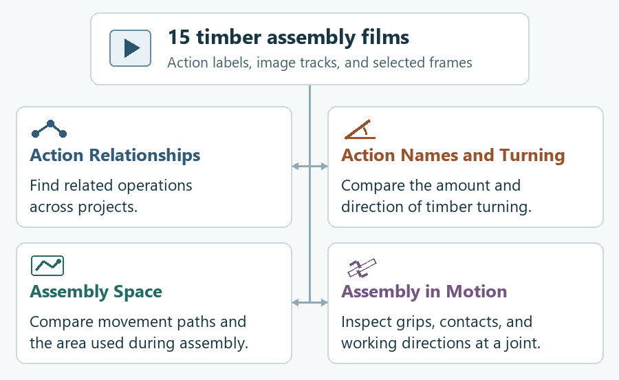
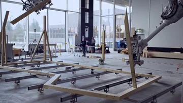
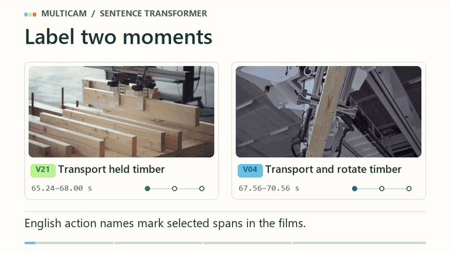
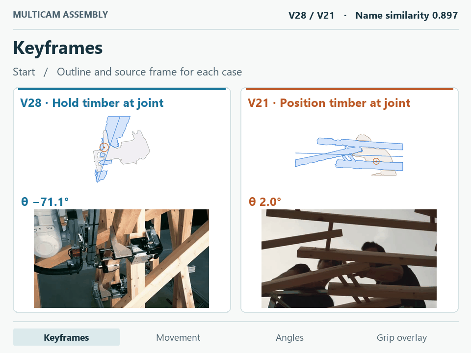
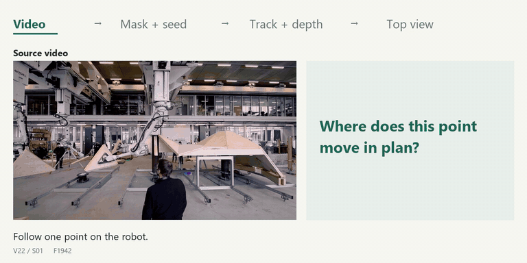
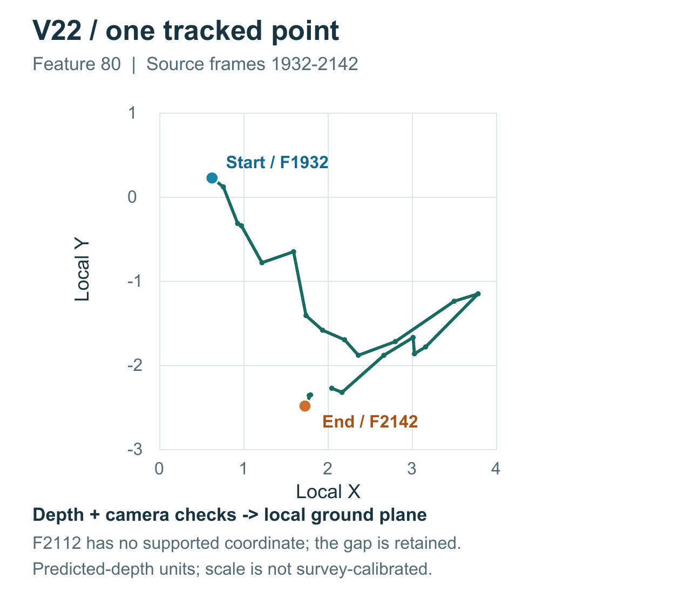
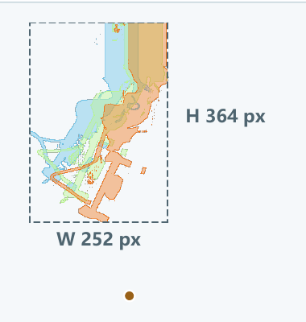

# MultiCam Assembly

## 1. Project overview

MultiCam uses 15 timber assembly films to study how people and machines bring members into place and how much space they use. The four analyses link that work to architectural drawings, from movement across the assembly area to adjustments at a joint.



### Quick Start

[Find related actions](#actions-and-movement) · [Compare turning](#action-names-and-turning) · [Explore assembly space](#from-video-to-top-view) · [Inspect a joint](#local-assembly-observations)

[Open the project website](https://yixumochi.github.io/multicam-assembly/) · [Browse all 15 cases](cases/README.md) · [Research code](research-code/README.md) · [Run a public example](#6-reproduction)

## 2. Cases and evidence

**Quick Start.** Open a case, then select an interval in its timeline to view the corresponding footage and drawings. [All 15 cases](https://yixumochi.github.io/multicam-assembly/#overview)

| Human-led | Human–robot | Robotic assembly |
| :---: | :---: | :---: |
| <a href="https://yixumochi.github.io/multicam-assembly/#human-led/V01"></a> | <a href="https://yixumochi.github.io/multicam-assembly/#human-robot/V04"></a> | <a href="https://yixumochi.github.io/multicam-assembly/#robotic-assembly/V22"></a> |
| [V01 · UTFSM timber frame](https://yixumochi.github.io/multicam-assembly/#human-led/V01) | [V04 · Spatial Timber Assemblies](https://yixumochi.github.io/multicam-assembly/#human-robot/V04) | [V22 · Semiramis](https://yixumochi.github.io/multicam-assembly/#robotic-assembly/V22) |

## 3. Research outputs

### Actions and movement

**Quick Start.** Open Action Relationships, search for `hold`, and select a connection to see two actions with related names. [Open Action Relationships](https://yixumochi.github.io/multicam-assembly/#action-connections)

The clip shows how SentenceTransformer compares two timber transport labels.

[](https://yixumochi.github.io/multicam-assembly/media/methods/sentence-transformer.mp4)

### Action Names and Turning

**Quick Start.** Select a point on the scatter plot to open the two recorded events. [Open the scatter plot](https://yixumochi.github.io/multicam-assembly/action-pair-summary/scatter.html) · [Start with V28 and V21](https://yixumochi.github.io/multicam-assembly/#action-pair=90:171)

V28 and V21 have a name similarity of **0.897**. From middle to end, their timber axes turn **+24.6°** and **−3.2°** in their respective camera images.

[](https://yixumochi.github.io/multicam-assembly/#action-pair=90:171)

### From video to top view

**Quick Start.** Choose two cases and compare their activity areas with their finished footprints. Follow V22 to see how a tracked point in the footage becomes a path in plan. [Compare two cases](https://yixumochi.github.io/multicam-assembly/spatial/compare.html) · [Watch the V22 walkthrough](https://yixumochi.github.io/multicam-assembly/video-to-top-view/index.html#workshop-plan)

[](https://yixumochi.github.io/multicam-assembly/video-to-top-view/index.html)

[](https://yixumochi.github.io/multicam-assembly/video-to-top-view/technical.html#animation)

The plot follows V22 feature 80 on the shot’s local ground plane. The workshop drawing uses a separate schematic projection. [Explore the Atlas of Assembly Space](https://yixumochi.github.io/multicam-assembly/spatial/index.html) · [See the technical walkthrough](https://yixumochi.github.io/multicam-assembly/video-to-top-view/technical.html#branch-results)

### Local assembly observations

**Quick Start.** Open V04’s *Approach local joint* board. Compare the masks across the three frames, then look at the marked contacts and working directions. [Open the V04 board](https://yixumochi.github.io/multicam-assembly/observation/index.html#V04/04) · [Browse Assembly in Motion](https://yixumochi.github.io/multicam-assembly/observation/index.html)

**Machine masks across three frames**

[](https://yixumochi.github.io/multicam-assembly/observation/index.html#V04/04)

**Masks aligned to the same timber point**

<a href="https://yixumochi.github.io/multicam-assembly/observation/index.html#V04/04"></a>

**Grip locations and directions**

[](https://yixumochi.github.io/multicam-assembly/observation/index.html#V04/04)

A and B mark the visible contacts. R is the result of an illustrative model with equal projected force magnitudes.

## 4. Reading order

Start with a film and its timeline, then pick the analysis that answers your question. [Cases and evidence](#2-cases-and-evidence) · [Quick Start](#quick-start)

## 5. Repository layout

| Location | Contents |
| --- | --- |
| [cases/](cases/README.md) | The 15 case folders with published videos and drawings, plus links to case pages and PDFs. |
| [research-code/](research-code/README.md) | Python workflows with module instructions for research analysis, boards, V01 mask refinement, V21 reconstruction, connector inference and training, and manuscript generation. |
| [examples/](examples/) and [docs/reproduction.md](docs/reproduction.md) | Small verification scripts, links to example inputs, and the instructions and status for each workflow. |
| [index.html](index.html), [action-pair-summary/](action-pair-summary/), [spatial/](spatial/), and [observation/](observation/) | Website source for timelines, action comparisons, space comparisons, and observation boards. Final PDFs are in [observation/boards/](observation/boards/). |
| [video-to-top-view/](video-to-top-view/), [body_five/](body_five/), [media/](media/), [plates/](plates/), [runs/](runs/), and [analysis/](analysis/) | Method walkthroughs, visual evidence, source fragments, and saved analysis used by the site. |

## 6. Reproduction

**Quick Start.** With Git and Python 3.11 or newer, run the public example. It checks the turning comparison and verifies 23 V22 drawing coordinates from saved image points.

```sh
git clone https://github.com/yixumochi/multicam-assembly.git
cd multicam-assembly
python examples/verify_published_examples.py
```

To browse the website locally, run `python -m http.server 8000` from the checkout and open `http://localhost:8000/`. For original inputs and verified workflow runs, see the [reproduction guide](docs/reproduction.md).
