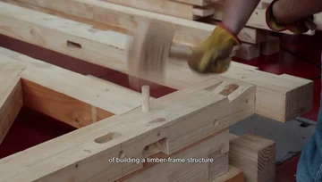
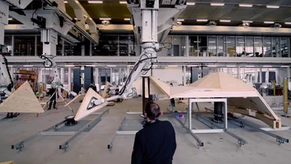
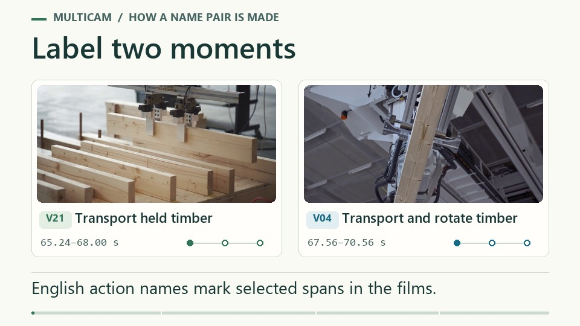
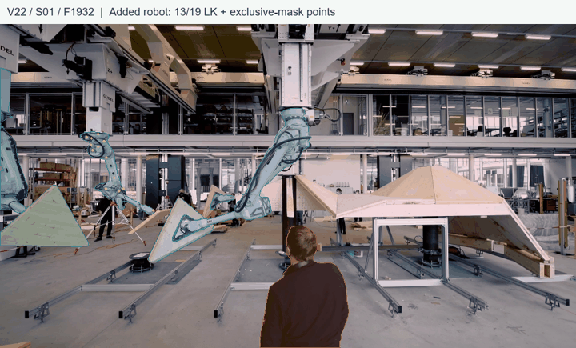
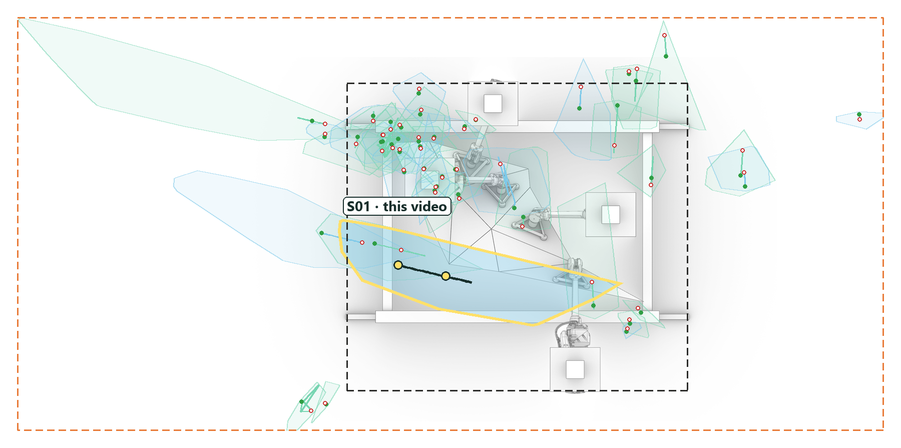
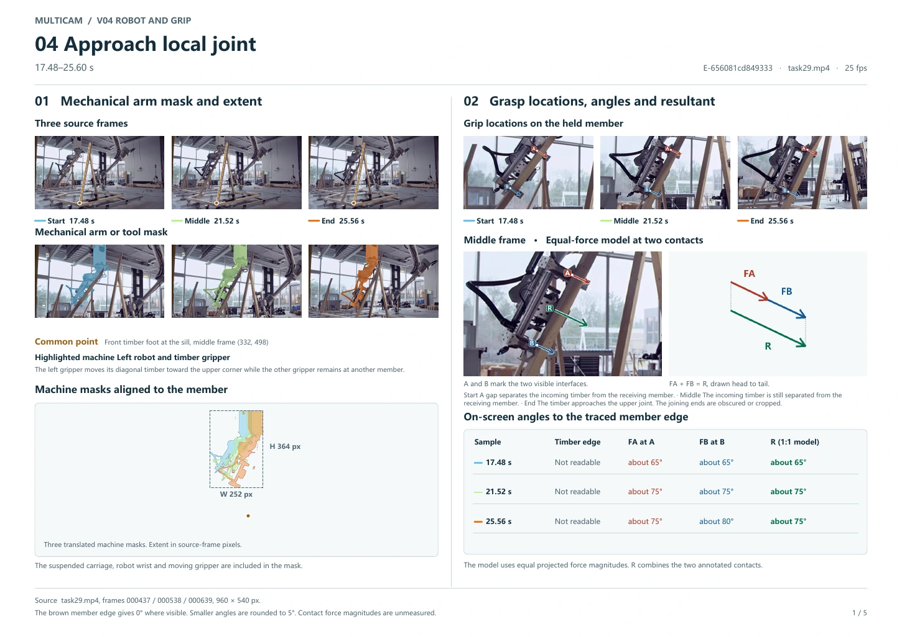

# MultiCam Assembly

## 1. Project overview

**How do people and robots assemble timber, and how much space do they use as they work?** MultiCam studies 15 filmed cases. Each case links the video to action timelines, drawings, and records of how people, machines, and timber parts move.

| Human-led | Human–robot | Robotic assembly |
| :---: | :---: | :---: |
| <a href="https://yixumochi.github.io/multicam-assembly/#human-led/V01"></a> | <a href="https://yixumochi.github.io/multicam-assembly/#human-robot/V04"></a> | <a href="https://yixumochi.github.io/multicam-assembly/#robotic-assembly/V22"></a> |
| [V01 · UTFSM timber frame](https://yixumochi.github.io/multicam-assembly/#human-led/V01) | [V04 · Spatial Timber Assemblies](https://yixumochi.github.io/multicam-assembly/#human-robot/V04) | [V22 · Semiramis](https://yixumochi.github.io/multicam-assembly/#robotic-assembly/V22) |

[Open the project website](https://yixumochi.github.io/multicam-assembly/) · [Browse all 15 cases](cases/README.md) · [Research code](research-code/README.md)

### Quick Start

**Explore in your browser.** Open V04 and follow the video and timeline together. Select the highlighted interval for *Approach local joint* to see how the three frames, machine masks, and grip directions relate. [V04 case](https://yixumochi.github.io/multicam-assembly/#human-robot/V04) · [Open the observation directly](https://yixumochi.github.io/multicam-assembly/observation/index.html#V04/04)

**Run a public example.** With Git and Python 3.11 or newer, run these commands.

```sh
git clone https://github.com/yixumochi/multicam-assembly.git
cd multicam-assembly
python examples/verify_published_examples.py
```

The script prints a **24.6° turning gap** for a pair of named actions and verifies **23 V22 drawing coordinates** from saved image points. It uses the data already in the repository.

## 2. Cases and evidence

1. **Collect the case material.** Link each source film to the available project drawings and references.
2. **Mark actions in the film.** Use Label Studio to attach an English action name to a time interval and keep representative frames.
3. **Prepare each comparison.** Use name similarity to select action pairs, use image tracks and geometry to produce plan views, and review selected frames for masks, contacts, and working directions.

[Case index](cases/README.md) · [Start here / Methods](https://yixumochi.github.io/multicam-assembly/)

## 3. Research outputs

### Actions and movement

Find related action names, then look at the footage and drawings to compare how each operation was performed. The example below pairs two timber transport actions from V21 and V04.

[](https://yixumochi.github.io/multicam-assembly/#action-connections)

[Action Relationships](https://yixumochi.github.io/multicam-assembly/#action-connections) · [Action Names and Turning](https://yixumochi.github.io/multicam-assembly/action-pair-summary/scatter.html)

### Assembly space

The V22 replay shows tracked points on a robot across the source frames. The workshop drawing shows a schematic placement of the track. The atlas uses the case plans to compare activity area and finished footprint across the 15 cases.

| V22 source frames and tracked points | Schematic placement on the workshop plan |
| :---: | :---: |
| <a href="https://yixumochi.github.io/multicam-assembly/video-to-top-view/technical.html"></a> | <a href="https://yixumochi.github.io/multicam-assembly/video-to-top-view/index.html"></a> |

[Video to top view](https://yixumochi.github.io/multicam-assembly/video-to-top-view/index.html) · [Technical walkthrough](https://yixumochi.github.io/multicam-assembly/video-to-top-view/technical.html) · [Atlas of Assembly Space](https://yixumochi.github.io/multicam-assembly/spatial/index.html)

### Local assembly observations

In V04, one robot brings a timber member toward a joint. The board aligns the equipment masks on the left and shows the contact points and projected working directions on the right.

[](https://yixumochi.github.io/multicam-assembly/observation/index.html#V04/04)

[Open the V04 observation](https://yixumochi.github.io/multicam-assembly/observation/index.html#V04/04) · [Assembly in Motion](https://yixumochi.github.io/multicam-assembly/observation/index.html)

## 4. Reading order

1. [Start here / Methods](https://yixumochi.github.io/multicam-assembly/) explains how the video evidence was prepared.
2. [Fifteen assembly cases](https://yixumochi.github.io/multicam-assembly/#overview) shows a video, timeline, and drawings for each case.
3. [Action Relationships](https://yixumochi.github.io/multicam-assembly/#action-connections) helps you find a pair of related operations.
4. [Action Names and Turning](https://yixumochi.github.io/multicam-assembly/action-pair-summary/scatter.html) compares wording with recorded turning.
5. [Atlas of Assembly Space](https://yixumochi.github.io/multicam-assembly/spatial/index.html) compares activity areas and footprints. [Compare two cases](https://yixumochi.github.io/multicam-assembly/spatial/compare.html)
6. [Assembly in Motion](https://yixumochi.github.io/multicam-assembly/observation/index.html) shows the masks, grips, and working directions for selected timeline intervals.

## 5. Repository layout

| Location | Contents |
| --- | --- |
| [cases/](cases/README.md) | The 15 case folders with published videos and drawings, plus links to case pages and PDFs. |
| [research-code/](research-code/README.md) | Python workflows with module instructions for research analysis, boards, V01 mask refinement, V21 reconstruction, connector inference and training, and manuscript generation. |
| [examples/](examples/) and [docs/reproduction.md](docs/reproduction.md) | Small verification scripts, links to example inputs, and the instructions and status for each workflow. |
| [index.html](index.html), [action-pair-summary/](action-pair-summary/), [spatial/](spatial/), and [observation/](observation/) | Website source for timelines, action comparisons, space comparisons, and observation boards. Final PDFs are in [observation/boards/](observation/boards/). |
| [video-to-top-view/](video-to-top-view/), [body_five/](body_five/), [media/](media/), [plates/](plates/), [runs/](runs/), and [analysis/](analysis/) | Method walkthroughs, visual evidence, source fragments, and saved analysis used by the site. |

## 6. Reproduction

1. **Serve the website locally.** From the checkout created in [Quick Start](#quick-start), run `python -m http.server 8000` and open `http://localhost:8000/`.
2. **Check the public results.** Run `python examples/verify_published_examples.py` in the checkout. The script recalculates the documented turning example and V22 drawing projection from the released results.
3. **Use the original inputs to rerun a specific workflow.** Follow the commands and expected outputs in the guide.

   | Workflow | Verified run and inputs |
   | --- | --- |
   | Actions and semantics | Local SentenceTransformer handoff and model. Reproduced all 210 historical vectors and 142 semantic groups. |
   | Assembly space | Released pixel positions. Reproduced the V22 drawing projection. Rerunning from source footage requires the original segmentation, tracking, depth, and camera-fitting code and settings. |
   | V04 observation boards | Local core research ZIP and rendering fonts. Regenerated the five retained pages from reviewed frames, masks, and annotations. |

   [Reproduction guide with setup and commands](docs/reproduction.md)
